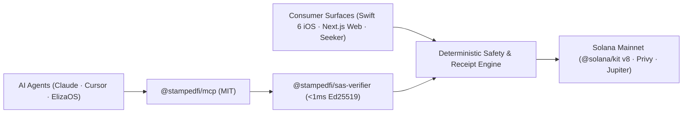

# Abigail (`@AbsCodeX`)

**Founder & Solo Systems Engineer · [StampedFi](https://stampedfi.com)** (`STAMPED Labs, Inc.`)

[stampedfi.com](https://stampedfi.com) · [shopmythesis.com](https://shopmythesis.com) · [X (@stampedfi)](https://x.com/stampedfi) · [Founder X (@this_girl)](https://x.com/this_girl)

---

### Building StampedFi — Boutique Consumer Token Discovery & Creator Conviction on Solana

Full-stack protocol, mobile, and data systems engineer combining **13+ years of enterprise data automation & Python verification pipelines** with **6 years of active on-chain market experience**.

### StampedFi Codebase Index

| Repository | Visibility | Stack | Scope |
| :--- | :---: | :--- | :--- |
| [**`stampedfi-protocol`**](https://github.com/AbsCodeX/stampedfi-protocol) | **Public (`MIT`)** | TypeScript · `@solana/kit` v8 · `tweetnacl` · MCP SDK | `<1ms` offline Ed25519 token safety verifier (`stamped-sas-v1`), Zero-Dox holder tier receipts (`stamped-tier-v1`), Solana Actions Blink guard & `x402` MCP server |
| **`stampedfi`** | `Private` *(Proprietary)* | Next.js 16 · React 19 · `@solana/kit` v8 · Drizzle | Production consumer web app ([stampedfi.com](https://stampedfi.com)), multi-source Solana swap ticket server, **Stamp Shield** Auto-2x triggers & **Shop My Thesis** storefronts |
| **`stampedfi-ios`** | `Private` *(TestFlight)* | Swift 6 · SwiftUI · Metal · watchOS | Native iPhone & iPhone Duo collectible card deck, **Token Camera Studio** (creator green screen & live charts), SMS **Gift-a-Stamp** & Apple Watch companion |
| **`stampedfi-solana-seeker`** | `Private` *(In Dev)* | Kotlin · Jetpack Compose · Seed Vault · MWA 2.0 | Native Android 15 client with system-wide `ACTION_PROCESS_TEXT` **Stamp Check** overlay, SGT hardware-human caller badges & NFC **Gift-a-Stamp** |

---

### Selected Open-Source & Quantitative Engineering

| Repository | Visibility | Domain | Highlights |
| :--- | :---: | :--- | :--- |
| [**`stampedfi-protocol`**](https://github.com/AbsCodeX/stampedfi-protocol) | **Public (`MIT`)** | Solana Security & MCP | Detached Ed25519 attestation verification, Zero-Dox conviction proofs & Model Context Protocol tools |
| [**`python-scaffold`**](https://github.com/AbsCodeX/python-scaffold) | **Public (`MIT`)** | Python 3.12+ Architecture | Modern typed Python project architecture with strict `ruff`, `mypy`, and `pytest` automation |
| [**`ai-autonomy-cheatsheet`**](https://github.com/AbsCodeX/ai-autonomy-cheatsheet) | **Public** | Agent Reliability | Interactive autonomy spectrum & human-in-the-loop governance reference for AI systems |
| **`pmxtrader`** | `Private` | Prediction Markets & Agents | Calibration-gated (ECE/Brier) prediction market trading system built around PMXT and MCP |
| **`polymarket-bot`** | `Private` | CLOB Market Infrastructure | Polymarket CLOB execution scaffold, market-data ingestion hub, and agent bridge |
